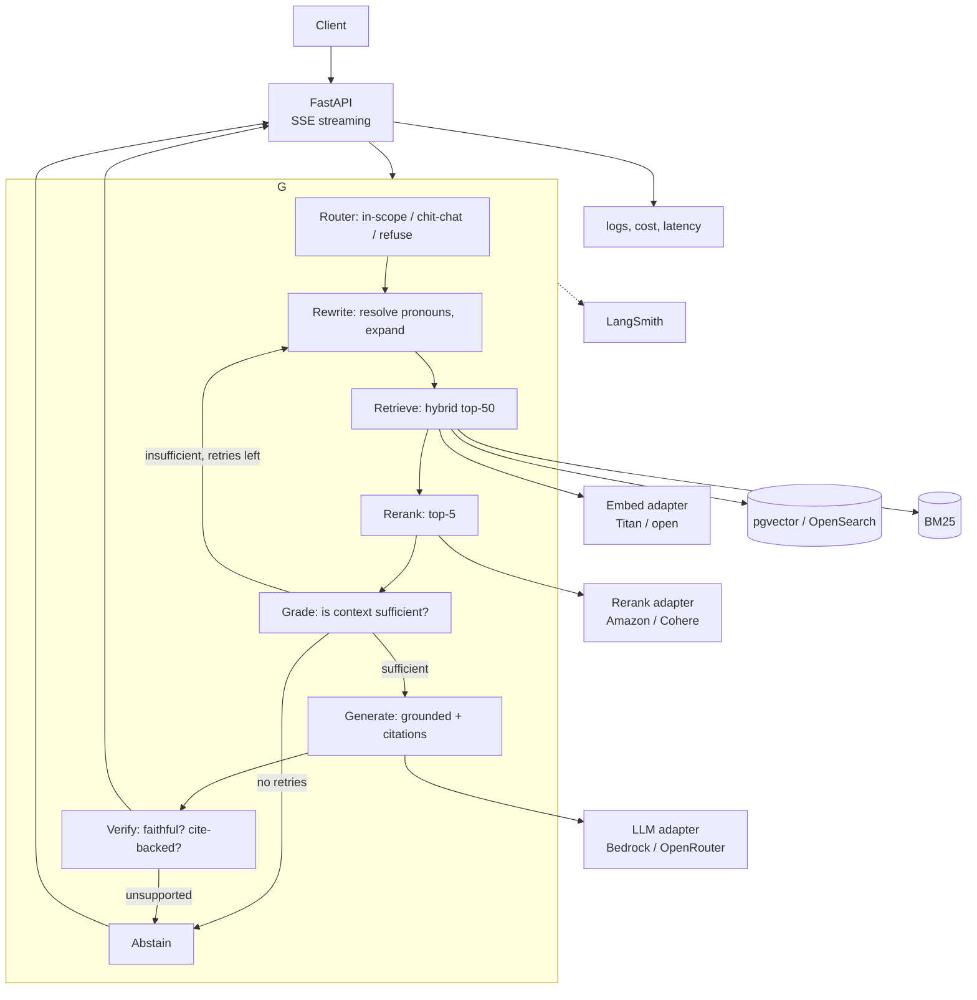

# From Lab to Product: an Agentic RAG App

The [Lab 3 notebook](./lab3-rag-evaluation.ipynb) proved the two hard parts: a
retrieval core that works (hybrid + rerank, `Hit@5 = 0.969`) and an evaluation
harness that separates retrieval failures from generation failures. This page turns
that into a **served, observable, agentic RAG app** built on **LangGraph + LangSmith
+ FastAPI**. It is the productisation path for Milestones 5–6 of the
[workplan](./workflow.md), and it records the decisions we already made while
building the lab.

## Constraints (read first)

These shape every choice below.

- **Region/billing blocks.** OpenAI, Anthropic and Google models are unavailable
  **both** on Bedrock (region) **and** on OpenRouter (billing address). The
  callable set is **open-weight and Amazon models only**. Do not design around
  frontier access.
- **The whole app must run on what is actually callable**, verified per model with
  a one-line probe before it is built into anything.
- **Data residency.** OpenRouter routes prompts to third parties. Fine for a
  portfolio corpus; a blocker only if we later claim enterprise readiness — hence
  the Bedrock path stays available as an adapter.
- **We optimise for evaluated quality, not model brand.** The harness decides.

## Decisions (chosen, and why)

| Decision | Choice | Why |
|---|---|---|
| Orchestration | **LangGraph** | stateful graph, retries, streaming; the agentic loop is the point |
| Observability + eval | **LangSmith** | traces, datasets, experiments; eval becomes the CI gate |
| Serving | **FastAPI** | SSE streaming, typed contracts, easy to containerise |
| Provider strategy | **Bedrock backbone + OpenRouter targeted**, behind one interface | Bedrock: in-region, versioned, cheap, no egress. OpenRouter: the only source of embedder diversity and newer open weights |
| Embeddings | **Titan V2 (Bedrock)** default | in-region, cheap, already integrated and cached |
| Embedding ablation | **done** — Titan vs self-hosted `qwen3-embedding:4b` via Ollama | measured: the embedder wins the dense race but the reranker absorbs it (see below) |
| Reranker | **Amazon Rerank (Bedrock)** | works; Cohere Rerank 3.5 is blocked on Bedrock (Marketplace) and must be re-checked on OpenRouter |
| Generation | **cheap-first**: Nova Lite for high-volume steps; strongest callable open model for the final answer | cost/latency where it matters, quality where users see it |
| Judge | a **different family from the generator** | with no frontier models, cross-family judging is the quality control |
| Chunking | **512 tokens, ~15% overlap, per chapter** | 256-token sentence-packed chunks were tested and rejected (`Hit@5` 0.83–0.86 vs 0.908) |
| Retrieval | hybrid (dense + BM25, RRF) → **rerank top-50 → top-5** | reranking lifted `Hit@5` 0.908 → 0.969 and correctness ~0.88 → 0.938 |
| Abstention | explicit policy + an `unanswerable` slice | the labs had no negatives; a chatbot must be able to refuse |
| Corpus | keep Harry Potter for demos; **use a non-memorised corpus for any quality claim** | closed-book control showed ~0.42–0.49 is latent memory |
| Gold set | grow to **200–500**, incl. `unanswerable` | 65 auto-generated questions (±2 rows of noise) can't certify anything |
| Repo strategy | **one product repo** owning app + eval + CI; lab stays separate | eval must gate the code it measures; splitting them causes drift |
| Vector store | Chroma (dev) → **pgvector/OpenSearch** (prod) | same cosine + hybrid contract, real scale |
| Caching | embeddings, rerank, **generation, judge** | generation is stochastic (58/65 answers changed across two runs); freeze a published run |
| Secrets | env/SSM at runtime, **never in the image** | a reference repo shipped `.env` inside its Docker image |
| Rendering | escape model output; **never** render LLM HTML (`\|safe`) | reference repo made model output an XSS/injection channel |

## Provider matrix (verify before building)

| Role | Primary | Alternative | Status |
|---|---|---|---|
| Embeddings | Bedrock **Titan V2** (kept) | self-hosted `qwen3-embedding:4b` (Ollama), or OpenRouter `bge-m3` | measured: Titan ties Qwen3 once reranked, at 1/2.5 the storage |
| Rerank | Bedrock **Amazon Rerank** | OpenRouter `cohere/rerank-v3.5` | Amazon works; Cohere blocked on Bedrock, **verify** on OpenRouter |
| Cheap generate/grade | Bedrock **Nova Lite** | small open models | works |
| Final answer / judge | strongest callable **open** model (DeepSeek / Qwen3 / Llama / GLM) | Nova Pro | **probe per model**; availability changes |

## Embedder ablation (measured)

Run via `labs/embedder_ablation.py`: same 249 chunks, same 65 labels (no
re-location — chunk ids are unchanged), with hybrid retrieval and Amazon Rerank
held fixed. Titan from cache; Qwen3 self-hosted through Ollama (2560 dims,
unit-normalised, query-instruction prefix).

| Embedder | Dense@5 | Hybrid@5 (hit / recall) | + Rerank (hit / recall / MRR) | Cand. Hit@50 |
|---|---|---|---|---|
| Titan V2 (Bedrock) | 0.862 | 0.908 / 0.900 | 0.969 / 0.962 / 0.882 | 64/65 |
| Qwen3-Embedding-4B (Ollama) | **0.954** | **0.938** / 0.923 | 0.969 / 0.962 / **0.885** | **65/65** |

**Decision: keep Titan V2.** The reasoning is the interesting part:

- **Dense-only, the embedder matters enormously** — +9.2 points of `Hit@5`
  (0.862 → 0.954). Titan really is a generation behind on the dense side.
- **In the shipped config it does not.** Hybrid → rerank top-50 → top-5 gives
  identical `Hit@5`/`Recall@5` (0.969 / 0.962) and MRR within 0.003. The reranker
  absorbs essentially the entire embedder advantage — it just needs the gold chunk
  somewhere in the top-50, which both provide.
- **So Qwen3 buys nothing on the metric that ships**, while costing 2.5× the vector
  storage (2560 vs 1024 dims) and a hosting story.
- The two remaining misses are the reranker's, not the embedder's.

**The coupling to remember:** if the reranker is ever removed for latency or cost,
the decision flips — Qwen3's dense `0.954` / hybrid `0.938` clearly beat Titan's
`0.862` / `0.908`. Re-run this table whenever the reranker's status changes; the
embedder and the reranker are not independent choices.

Ollama is a lab tool, not a deployment path: a local model server does not fit
Lambda/API Gateway. Keep Titan in-region for production.

## Target architecture



Every model call goes through an **adapter** so the provider is a config value, not
an architecture.

## Repository strategy

Two repos, split **R&D vs product** — not eval vs product.

```
product repo (new)
├── src/                # ingest, chunk, index, retrieve, rerank, generate
├── providers/          # bedrock.py, openrouter.py  (one interface each)
├── agent/              # LangGraph graph, nodes, state
├── api/                # FastAPI, SSE
├── eval/               # harness + gold set + thresholds   <-- lives WITH the app
├── tests/
└── .github/workflows/  # CI: lint, unit tests, eval gate
```

The lab repo (this one) stays the exploratory, write-up side and keeps the
copyrighted corpus out of the product. The harness travels into the product so CI
can gate on it.

## What carries over from the labs

| Lab artifact | Becomes |
|---|---|
| `harrypotter-chunks.jsonl`, embedding + rerank caches | ingestion output + warm caches |
| Retrieval + RRF + rerank code | `retriever` / `rerank` node internals |
| `qa_candidates.jsonl` + `results*.csv` | LangSmith dataset + baseline run |
| Judge, closed-book, abstention logic | `verify` node + offline eval |
| Failure taxonomy (workplan) | routing and retry rules |

## Phases

Each phase has a checkpoint; do not start the next until it passes.

### Phase 0 — Package the pipeline
Extract the notebook cells into a package behind the provider adapters.
**Checkpoint:** reproducing `Hit@5 = 0.969` from the package, not the notebook.

### Phase 1 — Single-shot FastAPI service
question → hybrid → rerank → generate → answer + citations, streamed over SSE. No
agent, no memory.
**Checkpoint:** matches the notebook's reranked answers on 20 sampled questions;
reports p50/p95 latency and cost per request.

### Phase 2 — Provider + embedding ablation (decide the stack)
Run the harness across what is callable: Titan vs open embedders × Amazon Rerank
vs Cohere (if allowed) × Nova Lite vs the strongest callable open model.
**Checkpoint:** one table that picks the embedder, reranker and model per role on
evidence, and records the pinned slugs.

*Embedder half is done — see [Embedder ablation](#embedder-ablation-measured):
Titan stays, Qwen3 wins only if the reranker goes.* Still to run: reranker
(Amazon vs Cohere) and the generation-model comparison.

### Phase 3 — LangSmith observability + eval as CI
Instrument every node; push the gold set as a dataset; run the harness as an
experiment per change; fail CI on regression beyond the noise band.
**Checkpoint:** a prompt change shows a metric diff automatically, with the noise
band stated (`±2 rows` at n=65).

### Phase 4 — Multi-turn memory + query rewriting
Session state in LangGraph; rewrite conversational queries before retrieval; add a
multi-turn gold set.
**Checkpoint:** "who trained *him*?" resolves correctly and is scored as its own row.

### Phase 5 — Agentic loop (the point of LangGraph)
Add **router, grade, rewrite/retry, verify, abstain** with a hard budget on LLM
calls.
**Checkpoint:** the graph **beats single-shot** on correctness on a non-memorised
corpus, and the extra latency/calls are reported. If it does not, keep single-shot
and say so.

### Phase 6 — Guardrails and safety
Treat retrieved text as untrusted; escape output; verify citations; apply the
abstention policy; log refusals.
**Checkpoint:** an injected document cannot change the answer; every citation
resolves to a real chunk.

### Phase 7 — Real corpus + expanded gold set
Move to a **non-memorised** corpus and grow the gold set to **200–500**, including
`unanswerable`.
**Checkpoint:** the closed-book control falls well below the augmented score.

### Phase 8 — Hardening and deploy
Production vector store, pooling, rate limits, CI eval gate, container (ECR) →
Lambda/API Gateway (SAM) or a container service, dashboards.
**Checkpoint:** one-command deploy; eval green; dashboards live.

### Phase 9 — Optional: managed baseline
Compare against **Bedrock Knowledge Bases** with the same harness.
**Checkpoint:** a paragraph on where the managed service wins and where the graph does.

## Eval gates (reuse the harness)

| Metric | Gate |
|---|---|
| `Hit@5` / `Recall@5` / `MRR` | no regression vs baseline |
| judge correctness | agentic ≥ single-shot on the non-memorised corpus |
| judge faithfulness | ≥ 0.95 |
| abstention | high on `unanswerable`, low on answerable |
| closed-book gap | augmented ≫ closed-book |
| latency / cost per query | reported and bounded |

## Conventions & reproducibility

- **Pin** model slugs + provider, embedding dimensions, chunking, `top_k`, fusion
  constant, reranker, and graph version. Aggregators float; record the exact slug.
- **Cache** embeddings, rerank scores, generation, and judge verdicts (key by
  `model | dimensions | input`) so a published run is reproducible despite
  stochastic generation.
- **Report ranges**, not single points, for generation metrics.
- **Judge ≠ generator family.**

## Deployment reference & pitfalls

The deployed reference is a Flask app on Lambda + API Gateway via Docker/SAM with
DVC for data. Its **deploy stack is worth copying**; these are the mistakes not to
repeat:

- don't commit the copyrighted corpus to a public repo;
- don't bake `.env` into the image;
- don't render model HTML with `|safe`;
- don't ship unpinned dependencies or Windows-only DVC paths.

## Risks

| Risk | Mitigation |
|---|---|
| Corpus the model memorised inflates scores | Phase 7 non-memorised corpus + closed-book control |
| Blocked models assumed available | probe per model; adapters keep swaps cheap |
| Agentic loop adds noise/cost without quality | Phase 5 gate vs single-shot |
| Auto-generated gold set hides errors | hand-review; add `unanswerable` |
| Injection via retrieved text | Phase 6 guardrails |
| Small eval (n=65) | Phase 7: 200–500 questions |

## Definition of done

A served, streaming app where every request is traced in LangSmith, the agentic
graph is measurably better than single-shot **on a corpus the model doesn't already
know**, non-answers are refused, every model call is swappable per provider, and CI
fails the build when retrieval or faithfulness regresses.
