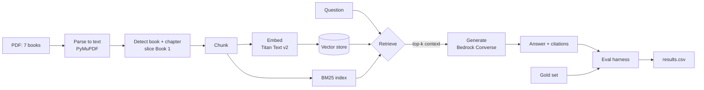

# Harry Potter RAG — Book 1

A first-principles RAG lab: take one long book, build a retrieval-augmented
question-answering loop from scratch, then measure how wrong it is.

This page is the **workflow map** — the order to build things in, the decisions
at each stage, and the checkpoints that tell you a stage is done. The code
lives in `lab.ipynb` next to this file; that notebook is the runnable artifact,
this page is the reasoning behind it.

!!! note "Learning goals"
    - Understand RAG as **two stages** — retrieve, then generate — not one black box
    - Feel which knobs actually move the numbers (chunking, retriever)
    - Build an evaluation that separates **retrieval failure** from **generation failure**
    - Keep the corpus small (one book) so each iteration is fast and cheap

## Corpus and ground rules

**Why Harry Potter:** it's clean prose, so PDF parsing is easy and your time
goes to the parts that matter (chunking, retrieval, eval). But the content is
not trivial — it's full of multi-hop questions, rare proper nouns, and aliases
(`You-Know-Who` = `Voldemort`), which is exactly what makes retrieval hard.

**Scope:** start with **Book 1 only**, from ingest through evaluation. Scale to
all 7 books only after the numbers move predictably on one.

!!! warning "Keep the text out of git"
    The PDF and the extracted full text are copyrighted. Add `data/`, `*.pdf`,
    the embedding cache, and the vector-store directory to `.gitignore`. Commit
    only your code, your own questions, metrics, and short snippets.

## The mental model



Two independent systems, two independent failure modes:

- **Retriever** — did the right passage make it into the top-k?
- **Generator** — given the right passage, did the model answer correctly and
  stay grounded in it?

If you only score the final answer, you can't tell which one broke. The gold
set below is what lets you split them.

## The workflow

| # | Milestone | Goal | Checkpoint |
|---|---|---|---|
| 0 | **Ingest** | PDF → clean, chapter-aware text for Book 1 | You can print a chapter map and read a clean page |
| 1 | **Baseline RAG** | Chunk → embed → index → retrieve → answer, end to end | Ask 3 questions you know the answers to and get sane answers |
| 2 | **Gold set** | Hand-write questions with evidence snippets | Every question has a findable evidence snippet |
| 3 | **Eval harness** | Score retrieval and generation separately | One `results.csv` you can re-run |
| 4 | **Ablations** | Vary chunking/retriever, compare | A single comparison table |
| 5 | **Scale** | All 7 books + write-up | Cross-book questions work |

Stay on Book 1 through Milestone 3. Reducing the corpus is what keeps the loop
fast.

### Components to build

Each milestone is just a few small pieces. This is the whole system, and each
row is a function you write:

| Component | Responsibility | Input → Output |
|---|---|---|
| Extractor | PDF pages → cleaned text | PDF path → list of page texts |
| Structurer | Find book/chapter boundaries | pages → chapter spans with metadata |
| Chunker | Text spans → overlapping chunks | text → list of chunk records |
| Embedder | Chunks → vectors (with disk cache) | list of strings → vector array |
| Vector index | Store + similarity search | vectors → top-k chunk ids |
| Retriever | Rank chunks for a query (dense / BM25 / hybrid) | query → ranked chunk ids |
| Generator | Answer from retrieved context, with citations | query + chunks → answer |
| Judge | Score an answer against gold | question, gold, context, answer → verdict |
| Harness | Orchestrate + compute metrics | gold set + config → `results.csv` |

### Milestone 0 — Ingest

**Parse.** Extract text page by page and keep the page number with each page —
you'll want it for debugging, not for scoring.

**Clean.** Novels in PDFs break in predictable ways:

- **End-of-line hyphenation** — `won-\nder` should become `wonder`
- **Running heads / page numbers** — repeated book title and digits on each page
- **Ligatures and smart quotes** — `fi`, `fl`, curly quotes
- **Blank or illustration pages** — drop or keep deliberately

Print one raw page next to its cleaned version. If the cleaned text reads like
a sentence, you're done.

**Structure.** Detect the Book 1 start/end page (scan for the title strings),
then detect chapter headings inside it. Book 1's chapters are numbered words
(`CHAPTER ONE`, `CHAPTER TWO`, …). Produce a chapter map: chapter number →
page range. This is what enables chapter-aware chunking later.

!!! tip "Checkpoint"
    A printed chapter map with 17 chapters and no obviously wrong boundaries.

### Milestone 1 — Baseline RAG

**Chunk.** Split into overlapping windows, and carry metadata on every chunk:
book, chapter, page range, token count, and a stable chunk id. Compare two
strategies from the start:

| Strategy | How | Why compare |
|---|---|---|
| Fixed-size | ~512 tokens with ~10–15% overlap | The baseline everyone uses |
| Chapter-aware | Split by chapter, then pack within the chapter | Stops a question and its answer being split apart |

**Embed.** Use **Titan Text Embeddings V2** (`amazon.titan-embed-text-v2:0`)
via `boto3`. Cache the vectors on disk keyed by a hash of the chunk text and
the model — re-runs then cost nothing and take seconds instead of minutes.

**Index.** Store vectors in a persistent local vector store (Chroma) so you can
inspect what actually got indexed. Index the same chunks with **BM25**
(`rank-bm25`) for the lexical side.

**Retrieve.** Implement three retrievers so you can compare:

- **Dense** — cosine similarity over embeddings
- **BM25** — exact-term lexical matching
- **Hybrid** — fuse the two rankings with Reciprocal Rank Fusion (`score = Σ 1/(k + rank)`, k≈60)

Hybrid matters here specifically: novels are full of rare names ("Quirrell",
"Nagini") where BM25 beats dense. Expect hybrid to win, and document it.

**Generate.** Call a chat model on Bedrock through the **Converse API** — one
code path for Claude or Nova, so swapping models is a one-line change. Prompt
rules that matter:

- Answer **only** from the provided context
- If the context doesn't contain the answer, say so plainly (don't guess)
- Cite the chunks used, as `[book, chapter]`

Wrap it in one `ask(question)` function that returns the answer *plus* the
retrieved chunks — you'll need both for evaluation.

!!! tip "Checkpoint"
    Ask "Who is Harry's godfather?", "What house is Hermione in?", and one
    question whose answer isn't in Book 1. The third should be refused.

### Milestone 2 — Gold set

This is the labor that makes the lab credible. Write questions **by hand**,
chapter by chapter — roughly 5 per chapter gives ~85. If you want a faster
start, do ~20 as a smoke test, then expand.

Mix the types deliberately: mostly `factoid`, some `multi-hop`, and a slice of
`unanswerable` (the model should refuse these).

Store each as one JSON object per line in `eval/qa_gold.jsonl`:

```json
{"id": "hp1-001", "book": 1, "chapter": 7,
 "question": "What is on the third floor corridor that students are warned to avoid?",
 "answer": "A three-headed dog (Fluffy)",
 "evidence": [{"chapter": 7, "contains": "three-headed dog"}],
 "type": "factoid"}
```

**Evidence is a short distinctive snippet, not a page number.** Editions
paginate differently; a snippet is robust and avoids quoting passages. A
retrieved chunk counts as relevant if it contains the snippet.

!!! warning "Don't let an LLM write your gold set"
    Auto-generated questions quietly bake in the model's own errors, and then
    your eval measures nothing. Write them yourself; use an LLM only to
    *draft candidates* that you then verify and fix by hand.

!!! tip "Checkpoint"
    Every question has at least one evidence snippet that you can find in the
    text, and the `unanswerable` ones genuinely aren't in Book 1.

### Milestone 3 — Eval harness

Score the two stages separately.

**Retrieval** (uses the evidence labels):

| Metric | Meaning |
|---|---|
| `Hit@k` | Share of questions with ≥1 relevant chunk in the top k |
| `Recall@k` | Share of evidence snippets found in the top k, averaged |
| `MRR` | Mean of `1/rank` of the first relevant chunk |

**Generation:**

| Metric | Meaning | Notes |
|---|---|---|
| `EM` / `F1` | Exact match / token overlap vs gold answer | Short factoid answers only; brittle on prose |
| Correctness (judge) | LLM judge: does the answer match the gold meaning? | Use a **stronger** model than the generator |
| Faithfulness (judge) | Is every claim supported by the retrieved context? | Catches hallucination even when the answer is "right" |
| Abstention rate | On `unanswerable` items, does it correctly decline? | Also track *false* abstention on answerable items |

The judge should return strict JSON (`correct`, `faithful`, `reason`) so you can
parse it. Hand-check ~10 judged examples once to confirm the judge agrees with
you before you trust it at scale.

Write one row per question to `eval/results.csv`, with columns:

```text
id, type, retriever, chunk_size, top_k, hit@k, recall@k, mrr,
em, f1, judge_correct, judge_faithful, judge_reason, abstained
```

!!! tip "Checkpoint"
    Re-running the harness on the same config gives the same numbers.

### Milestone 4 — Ablations

Now that you can measure, vary one knob at a time and compare in a single
table:

| Knob | Values to try |
|---|---|
| Chunk size | 256 / 512 / 1024 tokens |
| Chunking | fixed-size / chapter-aware |
| Retriever | dense / BM25 / hybrid |
| `top_k` | 3 / 5 / 10 |
| Reranker (optional) | off / on — a cross-encoder or Bedrock rerank over the top-k |

Report retrieval and generation metrics side by side, so you can see *why* a
configuration wins, not just that it does.

### Milestone 5 — Scale to 7 books

Only now ingest all seven. Detect each book's boundary, tag chunks with the
book, and add cross-book questions to the gold set. Watch for the new failure
mode: the right passage exists but competing near-duplicates from other books
crowd it out of the top-k.

## Failure taxonomy

When a question fails, classify it before fixing it:

| Failure | Symptom | Usual fix |
|---|---|---|
| Retrieval miss | Evidence not in top-k | Chunking or retriever |
| Hallucination | Fluent answer, unsupported by context | Prompt / grounding rules |
| Distractor | Evidence present, but model used a wrong chunk | Reranker / fewer chunks |
| Over-abstention | Refuses though the answer is present | Prompt / top-k |
| Under-abstention | Invents an answer to an unanswerable question | Stronger abstention instruction |

## Bedrock notes

- Enable model access in the console for **Titan Text Embeddings V2** and your
  chosen Claude/Nova models in your region.
- Titan V2 supports output dimensions 256/512/1024 and up to ~8k input tokens —
  chunk well under that.
- Use **Converse** for both generation and judging so the same code path works
  across model families.
- Cost is trivial at this scale: embedding one book is cents; per-query
  generation only sends the retrieved chunks.

## Repro checklist

Pin these so a re-run is reproducible: embedding model + dimensions, generation
model, judge model, chunk size and overlap, chunking strategy, `top_k`, fusion
constant, and the gold-set version (question IDs).

## Next steps

- Expand the gold set to the full ~80 questions
- Add a reranker and re-run the ablation table
- Compare against a **managed Bedrock Knowledge Base** as a baseline
- Scale to all 7 books with cross-book questions

## Related

- [Labs](../index.md) — the section this lives in
- [Lab examples](../lab-examples.md) — where this fits in a wider RAG portfolio
