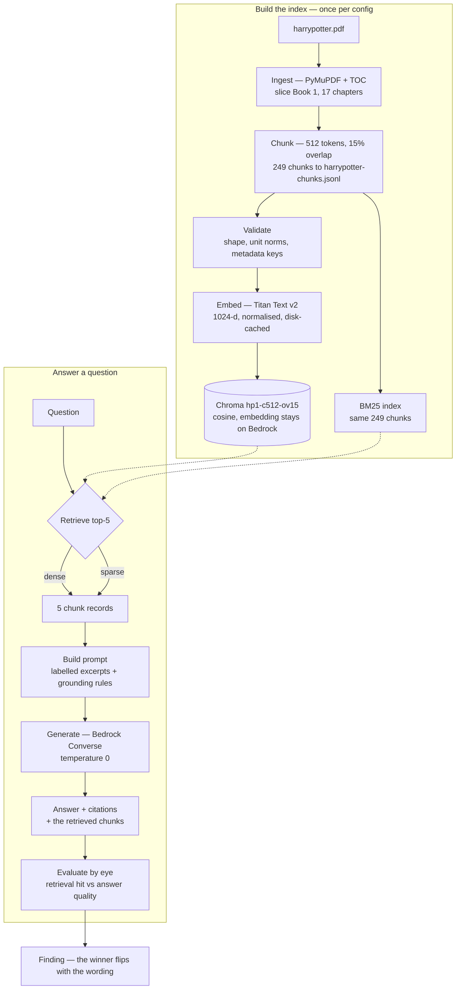

# Harry Potter RAG Lab

A demonstration of RAG pipeline using Harry Potter as the context.

- [Lab 1: Basic RAG](./lab1-basic_rag.ipynb)

- [Lab 2: Evaluation Prep](./lab2-evaluation-prep.ipynb)
- [Lab 3: Evaluation](./lab3-rag-evaluation.ipynb)

*Disclaimer: The source book is copyrighted and is not included in this repository. This lab is for personal, non-commercial study only — only original code, questions, and metrics are published.*